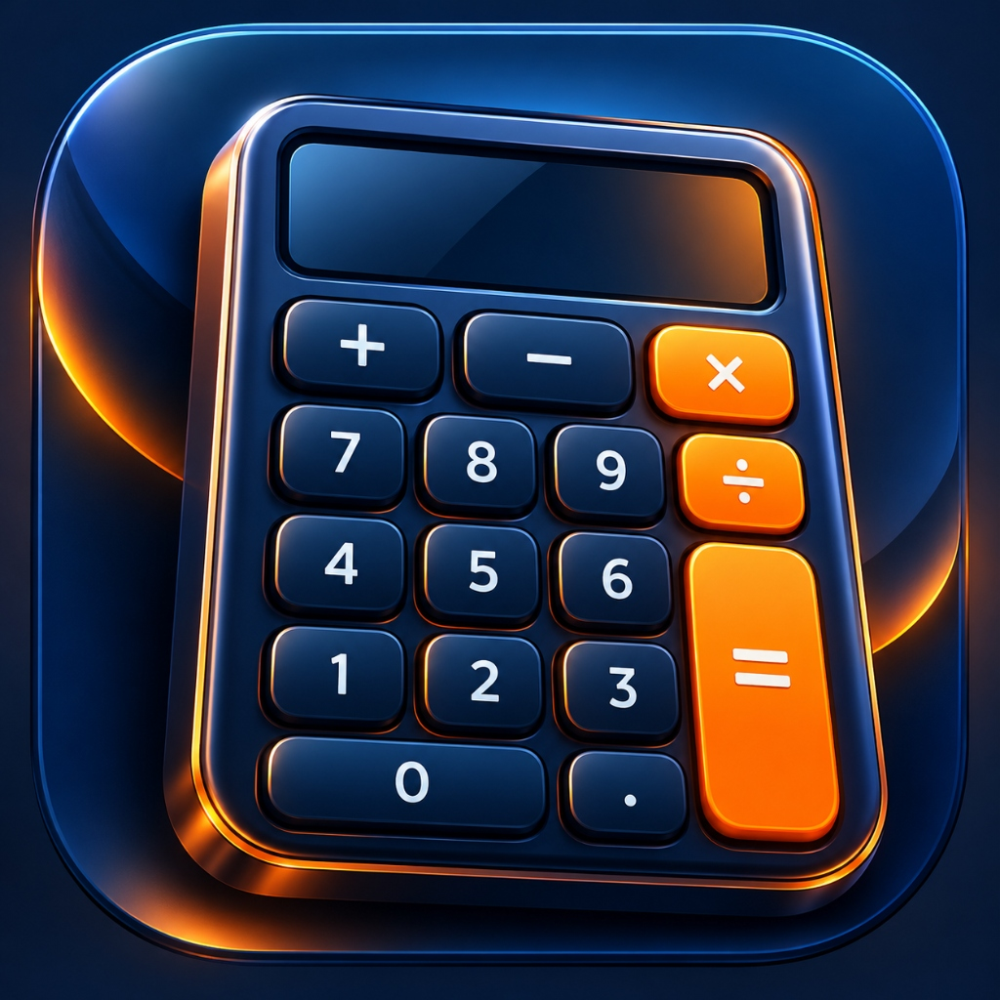

# 🧮 Pro Calculator

A modern, feature-rich calculator application built using **Flutter & Dart**, featuring a clean interface, scientific calculations, calculation history, and unit conversion.



## ✨ Features

- **Basic Calculator:** Addition, subtraction, multiplication, and division.
- **Scientific Calculator:** Advanced mathematical functions.
- **Calculation History:** View previous calculations.
- **Unit Converter:** Convert between supported measurement units.
- **Modern UI:** Custom-designed calculator interface.
- **Multi-Platform Project:** Flutter project structure for Android, iOS, Web, and Windows.

## 🛠️ Tech Stack

- **Flutter** — Cross-platform UI framework
- **Dart** — Programming language
- **Material Design** — User interface components

## 📂 Project Structure

```text
lib/
├── main.dart
├── models/
├── services/
├── theme/
├── views/
└── widgets/

assets/
└── icon/
    └── app_icon.png
```

## 🚀 Getting Started

### Prerequisites

- Flutter SDK
- Dart SDK
- Android Studio or VS Code
- Android emulator or physical Android device

### Installation

Clone the repository:

```bash
git clone https://github.com/omairalattab503-web/flutter-calculator.git
```

Navigate into the project:

```bash
cd flutter-calculator
```

Install dependencies:

```bash
flutter pub get
```

Run the application:

```bash
flutter run
```

## 🧪 Testing

Run the existing Flutter tests:

```bash
flutter test
```

## 📱 Screenshots

Screenshots of the application will be added here.

## 👨‍💻 Developer

**م عمير العطاب**

Built with Flutter & Dart as a practical mobile application development project.

## 📌 Project Status

Under development — improvements and new features are planned.

# Pro Calculator App

تطبيق حاسبة احترافية متكامل مبني بتقنية Flutter، يجمع بين الأداء العالي والتصميم الجذاب.

## الميزات الرئيسية:

- **حاسبة علمية متكاملة:** دعم العمليات الحسابية المتقدمة مثل الدوال المثلثية والجذور واللوغاريتمات.
- **شريط أدوات تفاعلي:** أزرار للتبديل بين الوضع العادي والعلمي، وعرض التاريخ.
- **واجهة مستخدم جذابة:** تصميم أنيق مع دعم الوضع الداكن ووضع الإضاءة و الوضع الليلي.
- **سجل العمليات:** حفظ جميع العمليات السابقة مع إمكانية استعراضها وحذفها.
- **تحويل الوحدات:** تحويل بين وحدات مختلفة مثل الطول والوزن ودرجة الحرارة وغيرها.
- **الوضع الليلي المتقدم:** تحويل الألوان تلقائياً لتناسب إضاءة الشاشة المحيطة.

---

## 🚀 كيفية التشغيل

### المتطلبات:

- Flutter SDK v3.0.0 أو أحدث
- Dart SDK v2.17.0 أو أحدث

### التثبيت:

1. استنساخ المستودع:
```bash
git clone <repository-url>
cd flutter-calculator
```

2. تثبيت الاعتماديات:
```bash
flutter pub get
```

3. تشغيل التطبيق:
```bash
flutter run
```

---

## 🛠️ التقنيات المستخدمة:

- **Flutter:** إطار العمل لبناء واجهات المستخدم متعددة المنصات
- **Dart:** لغة البرمجة
- **Provider:** لإدارة الحالة (State Management)
- **shared_preferences:** لحفظ بيانات المستخدم

---

## 🎨 تصميم الواجهة:

التطبيق مصمم ليكون سهل الاستخدام مع واجهة أنيقة تتكيف مع حجم الشاشة.

### الوضع العادي:


### الوضع العلمي:


### الوضع الليلي:


---

## 📋 سجل العمليات:

عرض جميع العمليات السابقة مع التاريخ والوقت.


---

## 🧮 العمليات المدعومة:

### العمليات الأساسية:
```text
+, -, ×, ÷, %, ^, √, !, 1/x
```

### العمليات العلمية:
```text
sin, cos, tan, asin, acos, atan
log, ln, e^x, 10^x
π, e, |x|
```

---

## 📝 الملاحظات:

- التطبيق لا يزال قيد التطوير وهناك خطط لإضافة المزيد من الميزات
- تم اختبار التطبيق على Android و iOS بنجاح

---

## 🤝 المساهمة

يسعدني استقبال المساهمات! يرجى رفع طلبات السحب (Pull Requests) للمراجعة.

---

## 📄 الترخيص

هذا المشروع مفتوح المصدر ومتاح للاستخدام والتعديل بحرية.

---

## 👨‍💻 المطور

**عمر العطاب**

---

## 🙏 الشكر

شكر خاص لمجتمع Flutter على الأدوات الرائعة والدعم المستمر.
